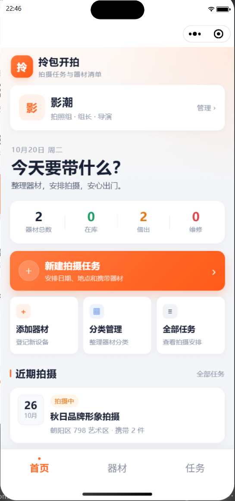
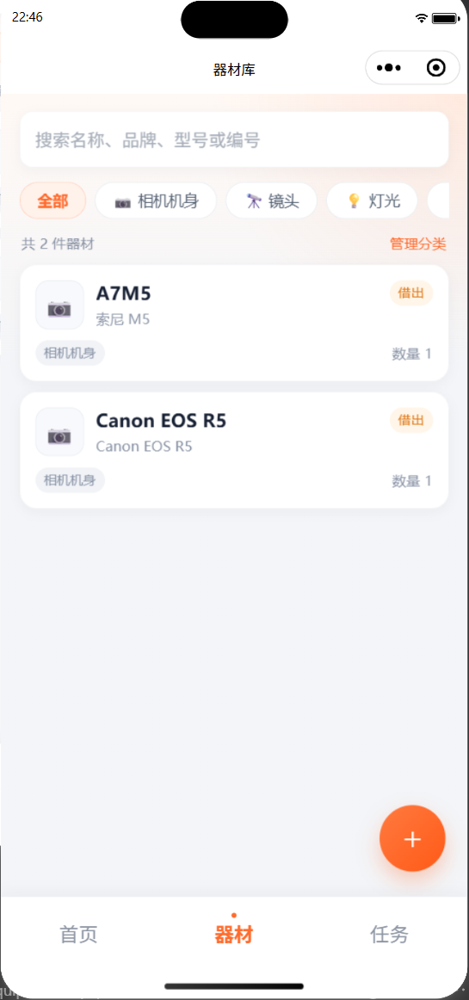
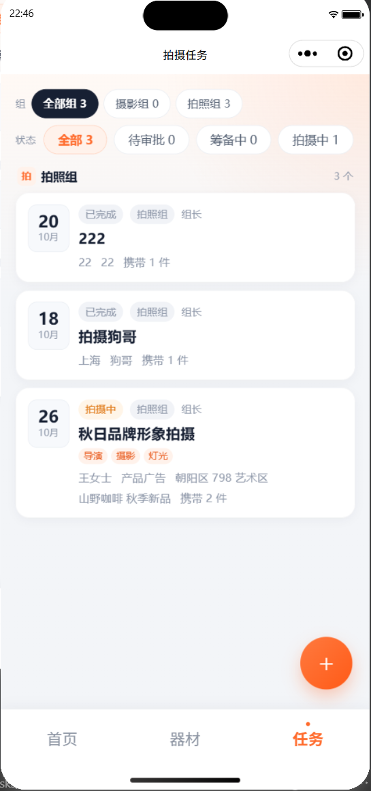
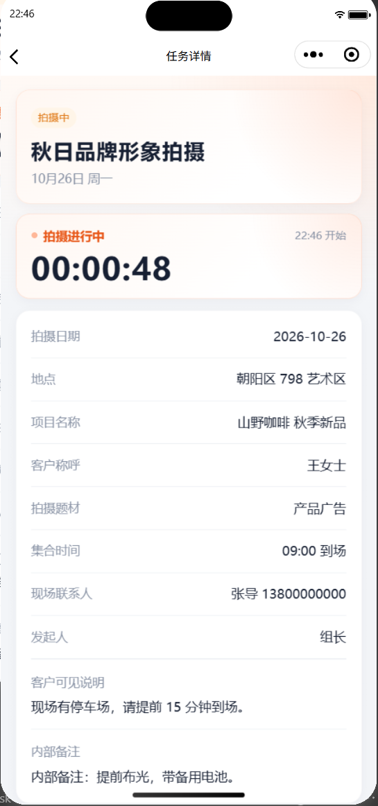

# 拎包开拍

**拍摄任务、器材清单与团队协作小程序。**

把拍摄排期、器材领用、任务确认和客户需求放在一个地方：谁在拍、拍什么、带什么、什么时候还，一眼看清。

> 此仓库仅用于产品介绍与体验入口，源代码不公开。

## 扫码体验

  

> 二维码 2026-10-31 前有效。

## 套餐

| 套餐 | 价格 | 器材 | 成员 |
| --- | --- | --- | --- |
| 免费版 | 0 元 | 30 件 | 3 人 |
| 专业版 | 299 元/年 | 1000 件 | 30 人 |
| 团队版 | 699 元/年 | 不限 | 300 人 |

体验版 2026-10-31 前免费开放。正式套餐关注公众号「SH漫影社」，回复「开通」购买激活码。

## 截图

  
  

  
  

## 功能

- **拍摄任务**：排期、地点、参与人、携带器材，任务状态一目了然
- **器材清单**：分类、在库 / 借出 / 维修状态、领用与归还记录
- **团队协作**：组长、器材管理员、成员角色与邀请码加入
- **客户分享**：任务分享链接、客户提交拍摄需求
- **云端同步**：微信云开发，换设备登录即可继续

## 交流群

  

> 群二维码 2026-10-31 前有效。

## 关于

- 平台：微信小程序（微信云开发）
- 购买与合作：公众号「SH漫影社」，回复「开通」
- 同作者作品：[SubTally](https://github.com/Caoran1314/SubTally) — 订阅管理与续费决策
